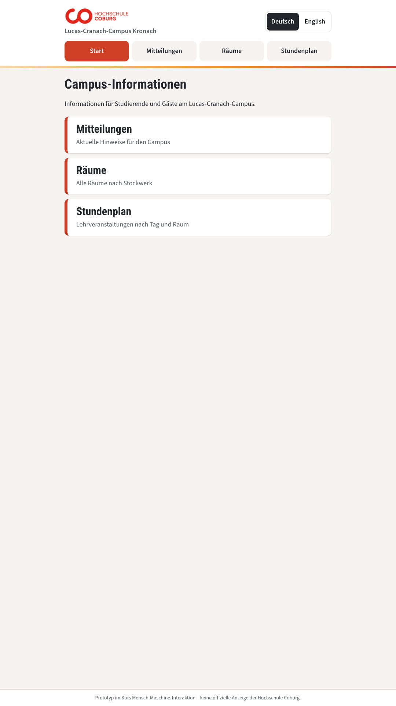
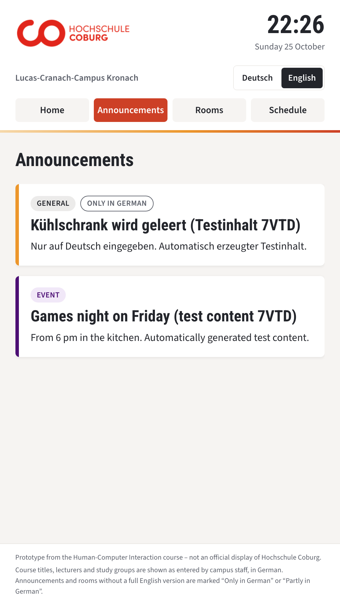
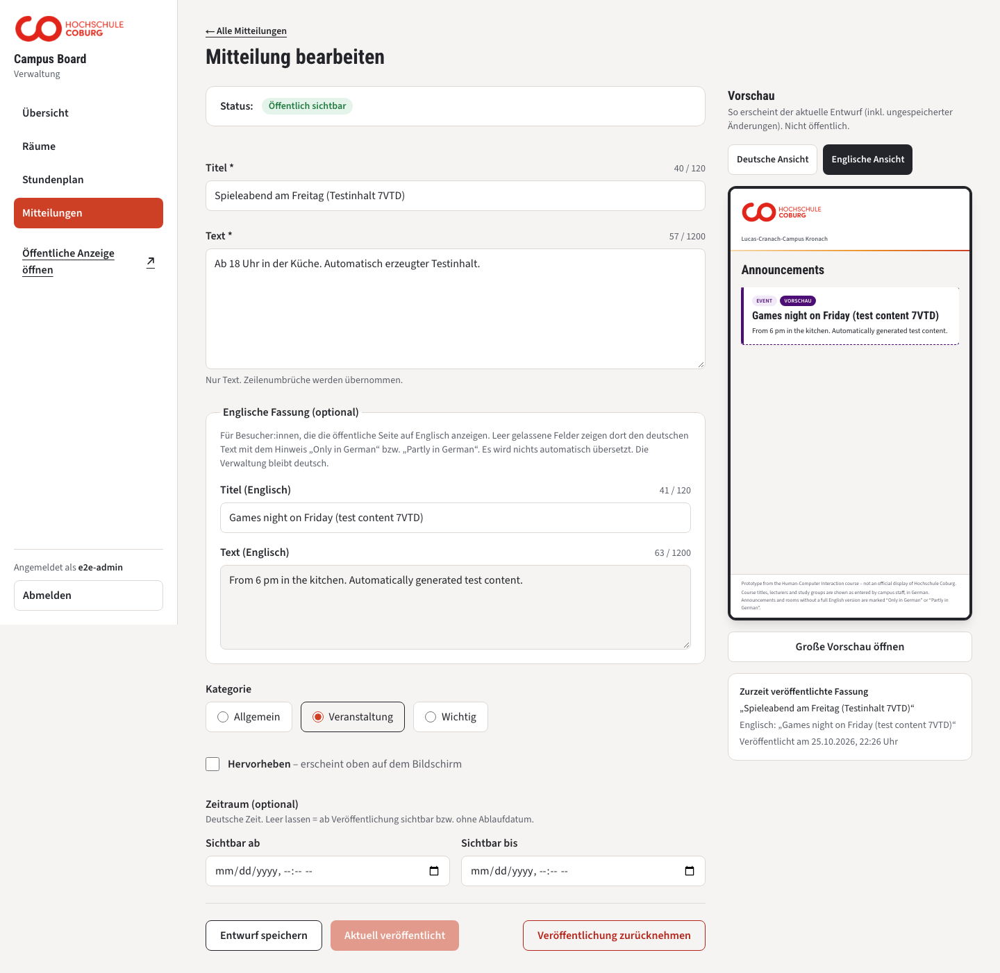

# Kitchen Dashboard — LCC Campus Board (prototype)

An interactive information board for the **vertical touch screen in the kitchen of Lucas-Cranach-Campus Kronach** (Hochschule Coburg), plus a separate **admin panel** for the person who keeps the content up to date (Katja).

This is a student prototype for the course *Mensch-Maschine-Interaktion* (Wirtschaftsinformatik 2.0). It is **not an official university system**. All rooms, sessions and announcements in the demo data are invented and labelled as such.

> **For teammates and their AI agents:** start with [What exists today](#what-exists-today), then [Rules for contributors and agents](#rules-for-contributors-and-agents) and the [Kanban board](#kanban-board-no-deadlines) at the end. The shared data contract is in [`docs/contracts.md`](docs/contracts.md).

---

## Team

| Member | Area (as agreed in the team) | Focus inside that area |
| --- | --- | --- |
| **Ali** (`al1mk`) | Architecture, admin panel, content management, shared data contracts | Platform, admin, data model; integration of the team modules (2026-10-31) |
| **Aryan** (also written "Arian") | Together with Parsa: three-floor map, room and class information | Delivered the original map V12.2 (floor illustrations, 47 room positions, search/zoom) |
| **Parsa** | Together with Aryan: class schedule and booking | Joint delivery with Aryan: booking module and map changes |
| **Reza** | Screen specifications and newcomer information | Delivered the newcomer page, prototype, sketches, booklet draft and research templates |

Aryan and Parsa delivered one **joint** package (booking + map changes); how they split that work is not known and is recorded as joint. Who supplied what, and which later changes are integration work, is listed in [`docs/contributions.md`](docs/contributions.md).

---

## What exists today

Two interfaces share **one persistent database**. Whatever Katja saves in the admin panel appears on the public pages within about 5 seconds, without anyone reloading the screen.

### Public side (kiosk and any browser, no login)

| Page | What a visitor sees |
| --- | --- |
| `/` | Start page with a large button for every section |
| `/newcomers` | "Neu am Campus": short task cards that lead to the map, schedule, notices and booking (static text; real contacts still missing) |
| `/map` | Campus map: three floor illustrations, search by room number or name, zoom, room details with links to its classes and to booking. Room names, floors and booking permission come live from the room list; positions are bound to the room id |
| `/rooms` | All rooms, grouped by floor, each with links to today's classes, the map and (if bookable) booking |
| `/schedule` | Classes of one day; previous/next day; optional filter by room (`?raum=<room id>`); cancelled classes stay visible as "Entfällt" |
| `/booking`, `/booking/cancel` | Demo booking: choose room, date, duration and a free start time; receipt with booking number and cancellation code (60-second countdown, "More time", "Done"); cancel with number + code |
| `/display` | Announcement board in portrait format (designed for the 1080×1920 screen) |

- Every public page has the **same navigation bar** (Start · Neu am Campus · Karte · Räume · Stundenplan · Raumbuchung · Mitteilungen) and **no link to the admin**.
- The map illustrations are **AI-generated drawings from Aryan's delivery**, not verified building or emergency plans; the page says so.
- **Deutsch / English switch** on every page. English is `?lang=en` in the address; German is the default. The language, the selected day and the selected room are kept when you move between pages.
- In English, texts that Katja has not translated are shown in German and marked **"Only in German"** or **"Partly in German"**. Course titles, lecturers, study groups and room codes are never translated.
- If the connection drops, the last known content stays visible with a "connection lost" notice, and the page keeps retrying.

### Admin side (Katja's laptop, German only)

| Page | What Katja can do |
| --- | --- |
| `/admin/login` | Log in (one local demo administrator; password is set locally, never stored in the repo) |
| `/admin` | Overview: active rooms, today's classes, cancellations, public announcements |
| `/admin/rooms` | Create, edit, archive and restore rooms; optional English name/description |
| `/admin/schedule` | 7-day view with room filter; create, edit, cancel and reinstate class sessions |
| `/admin/announcements` | Write a draft, preview it in portrait format (German and English view), publish, edit and republish, withdraw |
| `/admin/bookings` | See demo bookings (14 days, room filter) and cancel one after confirmation |

Important behaviour:

- **Announcements have drafts.** Saving never changes what the public sees; only "Veröffentlichen" does. This also applies to the optional English title/text.
- **Rooms and class sessions have no draft.** Saving makes the change public immediately, and every form says so.
- **Rooms are never deleted, only archived.** Archiving is refused while the room still has upcoming classes. Every room has a **fixed internal id** that never changes, even if its room number or name is corrected, so links from sessions (and later from the map and bookings) do not break.
- **The server checks everything:** no two classes in the same room at the same time; no class in an archived room; times are German time (Europe/Berlin), including the daylight-saving switch; end after start.
- **One occupancy rule for classes and bookings.** A class can't be saved over a booking (and vice versa); nothing is cancelled silently. Katja gets a link to the booking list instead. Check and save happen in one locked database transaction, tested with real parallel connections.
- **Booking is a demo with assumed rules:** 14 days ahead, 08:00–20:00, 15-minute steps, 15–120 minutes, no accounts. A room is bookable if Katja marks it "reservierbar"; the room number is not a permission. The cancellation code is created on the screen, stored only as a hash, and shown once.

### Not built or not tested yet

Verified newcomer facts and contacts, real room positions/timetable, the V2 visual redesign, online hosting, and **any test with real users or on the real campus screen**. See the kanban board and `docs/plans/team-integration-2026-10-31/02-progress.md`.

### Screenshots

These come from automated test runs with test content; 1080×1920 is a simulated portrait screen.

| Start page | Board in English | Admin editor with English preview |
| --- | --- | --- |
|  |  |  |

More screenshots are in [`docs/evidence/screenshots/`](docs/evidence/screenshots/).

---

## Quick start

**Requirements:** Node.js 22.18 or newer (tested with 22.20 on macOS), npm.

```bash
git clone https://github.com/Al1mk/kitchen-dashboard.git
cd kitchen-dashboard
npm install
npm run admin:set-password     # choose a local admin username + password; writes .env.local (hash only, git-ignored)
npm run db:seed-demo           # optional: demo announcements, 6 DEMO- rooms and one demo week of classes
npm run dev                    # http://localhost:3000

# Team demo (map rooms + booking) in a separate, disposable database:
export CAMPUS_BOARD_DB_PATH="$PWD/.demo-data/team-demo.sqlite"
npm run db:seed-team-demo -- --yes   # 48 map rooms with fixed ids (21 bookable), 4 demo classes; refuses data/
npm run dev
```

Then open:

- Public start page: <http://localhost:3000/> (English: <http://localhost:3000/?lang=en>)
- Announcement board: <http://localhost:3000/display>. This works best in a portrait window or full screen.
- Admin: <http://localhost:3000/admin/login>

**Production mode:** `npm run build && npm start`.

**Data:**
- The database is a SQLite file at `data/campus-board.sqlite`. It is git-ignored; every clone starts empty.
- It is created and upgraded automatically on start and **never reset**. To start over, stop the server and delete the file.
- To back it up, copy the file while the server is stopped.
- The demo seed only adds records; it never deletes anything. Demo rooms use invented codes such as `DEMO-E01`.

**Second device on the same network:** `npm start` listens on all interfaces, so another device can open `http://<your-ip>:3000/display` (on macOS: `ipconfig getifaddr en0`). Open the admin on the host itself via `localhost`; see `.env.example` for the LAN-only cookie option and its risk. This has **not** been tested on real devices yet.

---

## How it is built

| Part | Choice |
| --- | --- |
| Framework | Next.js 16 (App Router), React 19, TypeScript |
| Styling | Tailwind CSS 4. Colours and logo were sampled from the university website and are provisional ([`DESIGN.md`](DESIGN.md)). |
| Data | SQLite via `better-sqlite3`; migrations in `src/lib/db/migrations.ts` (schema version 4: bookings) |
| Validation | zod, on the server. Error messages are German and shown next to the field. |
| Live updates | Public pages ask the server every 5 seconds (simple and robust on a kiosk; no websockets) |
| Auth | One demo admin from `.env.local` (scrypt hash). Server-side sessions use a random token in an HttpOnly cookie. Every change must also come from the same origin (CSRF protection). |
| Tests | Vitest (unit, 136 tests) and Playwright (browser, 66 tests, production build, temporary database) — counts of the 2026-11-01 correction run (2026-10-31 integration run: 134/60) |

### Folder map

```text
src/
  app/                      pages and API routes (Next.js App Router)
    page.tsx                public start page
    display/ rooms/ schedule/ map/ booking/ newcomers/   public pages
    admin/                  admin pages (login + protected area)
    api/public/             read-only public API (announcements, rooms, schedule)
    api/admin/              write API, admin session required
  components/
    public/                 navigation, language switch, room directory, day schedule
    display/                portrait announcement board (also used by the admin preview)
    admin/                  admin forms, editor, dialogs
  lib/
    announcements/ rooms/ sessions/ bookings/   data rules, validation, database access
    occupancy/              one overlap rule for classes and bookings
    map/                    floor images, room positions (by id), team demo catalog and seed
    newcomers/              static newcomer text
    db/                     database connection and migrations
    i18n/public.ts          German/English text of the public pages and fallback rules
    time/berlin.ts          German time handling (DST-safe)
    auth/ http/             sessions, request checks, error responses
scripts/                    set admin password, demo seed, restart check
tests/unit/  tests/e2e/     Vitest and Playwright tests
docs/
  contracts.md              shared data contract and open integration questions  ← read this before integrating
  implementation-plan.md    file map and checklists per milestone
  evidence/                 test logs and screenshots of every milestone
```

### Public API (what the map, booking or newcomer pages can read)

| Endpoint | Returns |
| --- | --- |
| `GET /api/public/announcements` | Announcements that are published and currently visible |
| `GET /api/public/rooms` | Active rooms: `id`, `code`, `name`, `nameEn`, `floorId`, `type`, `description`, `descriptionEn`, `reservable`, `isDemo` |
| `GET /api/public/schedule?date=YYYY-MM-DD&roomId=<id>` | Classes of one Berlin day, optionally for one room |
| `GET /api/public/availability?roomId=<id>&date=YYYY-MM-DD` | Busy and free times of a bookable room (demo) |
| `POST /api/public/bookings`, `POST /api/public/bookings/<id>/cancel` | Create a demo booking; cancel with the code (see contract C5) |

All public responses contain `serverTime`, are never cached and contain only allowlisted fields. Times are UTC ISO strings. Full field lists and rules: [`docs/contracts.md`](docs/contracts.md).

**The most important rule for the map:** identify rooms by their **`id`**, not by the room number (`code`). The id never changes. To link from the map to a room's classes, use `/schedule?raum=<room id>`, and add `&lang=en` when the visitor is in English.

---

## Tests and evidence

```bash
npm run typecheck
npm run lint
npm test                    # unit tests (136)
npm run test:e2e            # browser tests (66): builds the app, seeds a temporary database with the team demo rooms, random password
scripts/verify-restart.sh   # restarts a production server and checks that all data survived (run npm run build first)
```

What the tests do and do not prove:

- "Two devices" in the browser tests are two separate browser sessions on one computer, not two physical devices.
- No test has been done with real users, with Katja, or on the real campus screen.
- Every milestone's logs and screenshots are in [`docs/evidence/`](docs/evidence/README.md), with test IDs T-01 to T-25; the team integration run is in [`docs/evidence/integration-2026-10-31/`](docs/evidence/integration-2026-10-31/README.md), the independent review in [`docs/evidence/review-2026-11-01/`](docs/evidence/review-2026-11-01/README.md) and its two corrections in [`docs/evidence/v1-corrections-2026-11-01/`](docs/evidence/v1-corrections-2026-11-01/README.md).
- Concurrency is tested with separate database connections in worker threads, not with physical devices.

---

## Project history (Ali's work so far)

| Step | What was done | Commit |
| --- | --- | --- |
| Setup | Next.js app scaffolded, stack chosen | `64d258a` |
| M1 | Announcements: login, draft, portrait preview, publish, edit/republish, withdraw, public board with live refresh | `73ac4eb`, `cff4509` |
| M1 review | Independent review findings R-001 to R-004 fixed (long cards were clipped, editor failed on plain-HTTP IP, seed used the wrong database, restart check without real assertions) | `c79f712` |
| M2 | Rooms (stable id, archive instead of delete) and class sessions (Berlin time, no double booking, cancel/reinstate); public room directory and daily schedule | `9c5dfcd` |
| Navigation + DE/EN | Public start page, one navigation on all public pages, German/English interface | `076c7d7` |
| English content | Optional English fields for announcements and rooms; marked German fallback; preview in both languages | `3dff61a` |
| Fix B-001 | Untranslated room names in the English schedule are marked in every row | `ad79b6a` |
| Team integration (branch `integrate/team-v1-20261031`) | Imported Aryan's map (`746f1e7`, subject "Aryan part"), the joint Aryan/Parsa booking package (`a06edaa`, "Aryan + Parsa part") and Reza's newcomer work (`c2fd85a`, "Reza part") unchanged — Ali committed the imports, the work is theirs; then Ali's integration: ID-bound map in the shared shell, one occupancy rule, booking fixes (pending request, no room substitution, translations, receipt), Katja's booking list, newcomer page | `76f789b` … see `docs/contributions.md` and `docs/history-mapping-2026-11-01.md` (older documents quote pre-publication SHAs) |

**How AI was used:** Ali's code, tests and documentation were written with **Claude Code** (Anthropic) at Ali's direction and reviewed by Ali step by step. Independent reviews, the 2026-10-31 source audit and the integration plan were done with **Codex** (OpenAI). The 2026-10-31 integration of the team modules was carried out with Claude Code. The teammates' own deliveries state their own tool use (e.g. the map illustrations are described as AI-generated). All test results above are automated; no human usability test has been done yet.

---

## Rules for contributors and agents

If you (or your AI agent) work on this repository:

1. **Read [`docs/contracts.md`](docs/contracts.md) first.** It defines the shared data and lists the open questions the team still has to agree on.
2. **Reference rooms by `id`.** Never invent official room numbers. Real codes must come from the campus or the team; demo codes start with `DEMO-`.
3. **Do not change other people's modules without agreement.** (Exception recorded on 2026-10-31: Ali asked for the necessary integration fixes; they are separate commits listed in `docs/contributions.md`.) Add your feature as a new module (for example `src/app/map/`, `src/lib/bookings/`) and talk to the owner before changing shared code (`src/lib/rooms`, `src/lib/sessions`, `src/lib/db/migrations.ts`, auth).
4. **Database changes:** never edit an existing migration. Append a new one to `MIGRATIONS` in `src/lib/db/migrations.ts`, and make sure existing data survives (there is a migration test to copy from).
5. **Public pages:** use `PublicShell` / `PublicNav` so your page gets the shared navigation and the Deutsch/English switch. Put interface text in `src/lib/i18n/public.ts` in both languages. Keep links language-aware with `publicHref(path, lang, params)`.
6. **Admin pages are German.** Public pages are German and English.
7. **Public write actions (for example booking) need their own narrow public endpoint.** Never expose the admin API to the kiosk. Check booking conflicts on the server, atomically, against class sessions too.
8. **Never commit secrets or local data.** `.env.local`, `data/`, `test-results/` and `.next/` are git-ignored. Configure credentials locally (`npm run admin:set-password`).
9. **Before pushing:** `npm run typecheck && npm run lint && npm test && npm run test:e2e` must pass.
10. **Be honest in docs:** keep "planned", "built" and "tested" separate, and record AI assistance.

---

## Kanban board (no deadlines)

**How to use it:** move a card by changing its **Status** in the card list and its place in the board overview, in the same commit as the work. Card owners marked *(proposed)* are suggestions; confirm them in the team. Statuses: **Backlog**, **To do**, **In progress**, **Needs decision**, **In review**, **Done**.

### Board overview

| Backlog | To do | In progress | Needs decision | In review | Done |
| --- | --- | --- | --- | --- | --- |
| G-3, G-4 | R-1, G-1, G-2 | R-2 | S-3, S-4, S-5, S-6, K-6, K-7 | K-5, I-1, A-1, A-2, A-3, A-4, A-5, P-1, P-2, P-3, P-4, P-5, R-3, S-1, S-2 | K-1, K-2, K-3, K-4 |

"In review" for team cards means: implemented and covered by automated tests on the integration branch, waiting for the team's review. It does not mean tested with people.

### Cards

#### Ali — admin panel, data and integration

| Card | Task | Status | Notes / done when |
| --- | --- | --- | --- |
| K-1 | M1: announcements from draft to public board | Done | Draft, preview, publish, edit/republish, withdraw; tested (T-01 to T-09) |
| K-2 | M2: room and class-session administration with public room directory and schedule | Done | Stable room ids, archive guard, no double booking, Berlin time; tested (T-10 to T-14) |
| K-3 | Public start page, shared navigation, Deutsch/English interface | Done | Tested from `/` by clicking only (T-15 to T-17) |
| K-4 | Optional English content for announcements and rooms, fix B-001 | Done | Tested incl. upgrade of existing data (T-18 to T-25) |
| K-5 | Manual walkthrough of M2 and the bilingual features by Ali | In review | Ali creates a room and a session, edits them, and checks `/rooms`, `/schedule` and `/display?lang=en` |
| K-6 | Kiosk idle behaviour: which page is the idle screen (`/` or `/display`), and should the screen return to Start/German after inactivity? | Needs decision | Team/V2 decision; agree with Reza (screen) |
| K-7 | Warn when the German text changes after an English version exists | Needs decision | Not built; decide whether it is needed |
| I-1 | Integrate the three team deliveries into one V1 | In review | Branch `integrate/team-v1-20261031`; typecheck/lint/134 unit/60 browser/restart green on 2026-10-31; review findings V1-R001/V1-R002 fixed 2026-11-01 (`27ef96b`, pre-publication `9144cff`; 136 unit/66 browser/restart green); see `docs/contributions.md` |

#### Shared decisions — Ali with Arian and Parsa (blocks map and booking)

| Card | Decision needed | Status | Current assumption in the code |
| --- | --- | --- | --- |
| S-1 | How does the map identify a room? | In review | Implemented: positions bound to room `id` (`src/lib/map/config.ts`); a corrected room number keeps the marker. Team to confirm. |
| S-2 | Which floors exist? | In review | `EG`, `1OG`, `2OG`, `3OG` (3OG added for Aryan's map). Real floor naming still to be confirmed. |
| S-6 | Who confirms the joint Aryan/Parsa split and the demo booking rules? | Needs decision | Joint attribution and the demo rules are recorded as assumptions |
| S-3 | Real room numbers and names | Needs decision | None in the system; only invented `DEMO-` rooms |
| S-4 | Study group ("cohort"): free text or a fixed list? | Needs decision | Free text. A list would allow filtering, but needs real data. |
| S-5 | Term rule | Needs decision | `WS 2026/27` / `SS 2027`; WS assumed to be October–March |

#### Arian — map *(proposed owner)*

| Card | Task | Status | Notes / done when |
| --- | --- | --- | --- |
| A-1 | Three-floor map as a public page inside the shared navigation | In review | New module, e.g. `src/app/map/`, using `PublicShell`. Must not rebuild the existing pages. Depends on S-1, S-2. |
| A-2 | Map shapes linked to rooms | In review | Read `GET /api/public/rooms`; mapping *map shape → room id*; show `name` or `nameEn` depending on language |
| A-3 | Tapping a room opens its classes | In review | Link to `/schedule?raum=<id>` and keep `&lang=en` |
| A-4 | Room search / selection on the map | In review | Touch-friendly; large targets (at least 56 px) |
| A-5 | Map in English | In review | Labels in `src/lib/i18n/public.ts`; room names follow the existing fallback rule |

#### Parsa — booking and free time *(proposed owner)*

| Card | Task | Status | Notes / done when |
| --- | --- | --- | --- |
| P-1 | Booking rules for the prototype | In review | Time slots, which rooms are bookable (`reservable` flag already exists), blocked times; write the assumptions down |
| P-2 | Book and cancel without a student card | In review | Separate public write endpoint (never the admin API). Cancelling needs a booking token, not "anyone can cancel anything". |
| P-3 | Server-side conflict check | In review | Atomic; two requests can never get the same slot; booking must not collide with class sessions. A changed class must not silently overlap an existing booking. |
| P-4 | Admin view: see and cancel bookings, block time slots | In review | List + cancel built (`/admin/bookings`). Blocking time slots is **not** built (a class session can block a room). |
| P-5 | Free-time / calendar view for students | In review | Shows when a room is free, based on sessions and bookings; minimal public data (no personal information) |

#### Reza — screen and newcomers *(from the team split)*

| Card | Task | Status | Notes / done when |
| --- | --- | --- | --- |
| R-1 | Collect the real screen data: model, resolution, size, browser, touch | To do | Needed to replace the assumed 1080×1920 |
| R-2 | Content for newcomers ("first time here") and contacts | In progress | Text material first; needs to be editable in the admin later (M3) |
| R-3 | Link newcomer content to rooms/floors by shared id | In review | Uses room `id` and `floorId` from the contract |

#### Whole team — testing, V2 and report

| Card | Task | Status | Notes / done when |
| --- | --- | --- | --- |
| G-1 | First test on the real screen and a second device | To do | Record what actually happened (device, browser, network); no claims without a real run |
| G-2 | Usability test with someone outside the team (and Katja if possible) | To do | Three tasks: publish an announcement, find a room, book a slot. Write down observations, help needed and errors; no invented numbers. |
| G-3 | V2 design based on the test findings | Backlog | Finding → proposed change → decision → before/after screenshot → retest. The official palette must be confirmed first. |
| G-4 | Hosting / deployment option and integration of all modules (M5) | Backlog | Local SQLite is not durable on serverless hosting; hosting is an open decision |
