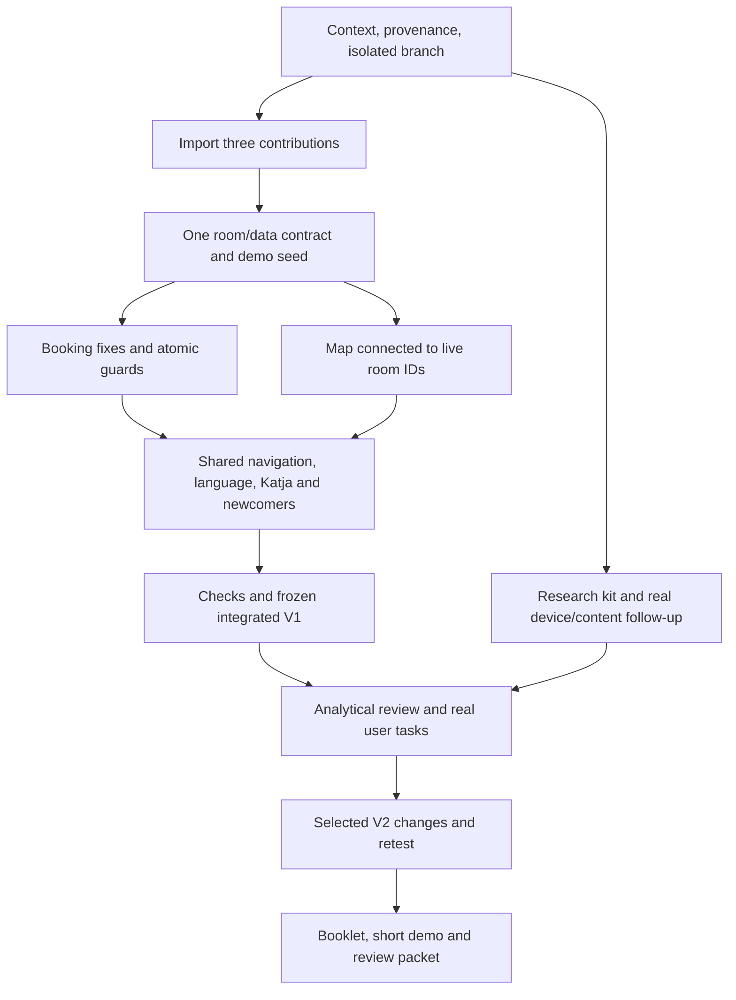

# Integrated V1 and HCI iteration — Implementation Plan

> **For agentic workers:** REQUIRED: Use superpowers:subagent-driven-development (if subagents available) or superpowers:executing-plans to implement this plan. Steps use checkbox (`- [ ]`) syntax for tracking. Delegate only disjoint files, protect shared files, and have one owner update progress/vault notes. Do not create extra user chats. The present deliverable is a plan; do not execute it in the planning turn.

**Goal:** Integrate the existing teammate prototypes into Ali's application, fix known failures, produce a reviewable V1, then document and evaluate focused UI/UX improvements.

**Architecture:** Keep Next.js, the existing SQLite database/services, authentication and stable opaque room IDs. Reuse supplied map assets/logic, booking code and newcomer content. Use a deterministic opt-in demo seed plus static ID-bound geometry and live room metadata; keep admin and public UI separate.

**Tech Stack:** Existing Next.js 16.4.3 / React / TypeScript / Tailwind / better-sqlite3 / Zod / Vitest / Playwright. No new framework or service.

All application paths below are relative to `/Users/alimk/Documents/university/Coburg/Mensch-Maschine-Interaktion/Project/campus-board`. Source package paths are defined in [the brief](00-brief.md). **Task state lives in [02-progress.md](02-progress.md).** Checkboxes are initially unexecuted steps. Do not mark a task VERIFIED until its acceptance check has actually run.

> **Checkbox reconciliation, 1 November 2026:** after the independent review (0 checked / 171 unchecked), steps were checked only where commits, tests or documents in [02-progress.md](02-progress.md) and the evidence folders support them. Unchecked steps carry a note when they are partial, blocked, human-dependent or deferred; task state remains authoritative in the progress board. Nothing human-dependent was checked.

## Execution rules and priority

- **P0:** T00–T17 and T19: coherent technical integration. Finish these before decorative redesign.
- **P1:** T18, T20–T23, T25–T29: HCI evidence, evaluation and delivery. Prepare what is possible now; human-dependent steps stay explicit.
- **P2:** T24's optional polish beyond observed usability defects. Drop optional scope before dropping P0 checks.
- Tonight's target is an integrated, runnable, tested checkpoint and prepared HCI materials. Do not promise that people, hardware and all submission work will become available tonight.
- Existing source audit/evidence is read once. Reinspect changed paths and reproduce relevant failures; do not restart the entire investigation.
- New runtime files use existing patterns. Read relevant installed Next docs first. Tests must exercise behavior, not mirror implementation.
- At the end of each task: update its board row, step checkboxes, evidence/change ledger and Persian vault checkpoint. Commit by coherent ownership/change boundary; no unrelated files or fake authors.
- Human statements, hypotheses, code existence, automated evidence and human observations are different states.



## Chunk 1: Establish the workspace and import contributions

### T00 — Reconcile context and current state [P0]

Depends: none. Files: existing `AGENTS.md`, parent `Project/CLAUDE.md`, README, contracts, audit; `02-progress.md`.

- [x] Read the brief, plan, master prompt, source audit, and vault HCI-00/09/15 plus latest HCI-05. Read this turn's new plan notes when present.
- [x] Record current branch, HEAD, remote tracking state and dirty/untracked paths. Compare with last audited `4ae9808`; preserve newer work.
- [x] Inspect package scripts and installed Next docs needed for route/query/admin changes. Do not reinstall/update dependencies without a concrete need.
- [x] Explain the next executable task and known existing checks in one short terminal update. Distinguish historical audit results from current runs.
- [x] Start a checkpoint in `02-progress.md`; leave all implementation tasks TODO until performed.

Acceptance: a truthful starting SHA/state and next task; no resets, migrations or changes to user data.

### T01 — Provenance and commit attribution [P0]

Depends: T00. Create `docs/contributions.md`; reference `docs/evidence/team-audit-2026-10-31/source-manifest.json`. Review parent `Project/CLAUDE.md` attribution guidance without changing global settings.

- [x] Verify the supplied folders still match the audit's hashes or record exact differences. Keep originals immutable.
- [x] Record Aryan original, joint Aryan/Parsa changes, Reza source/docs, and Ali's platform separately. Mark precise joint authorship UNKNOWN rather than guessing.
- [x] Separate imported source, integration fixes and AI-assisted generation in the ledger. Do not assign newly written fixes to an original contributor.
- [x] Apply Ali's later instruction permitting name-only contributor import commits over the older Ali-only rule **for these imports only**. Preserve the no-AI-trailer rule.
- [x] For known imports use the supplied human name with an empty email only if Git accepts it; for the joint import use an explicitly joint display label. Explain that this does not associate GitHub accounts. Never invent email/GitHub identities. If tooling rejects empty-email authors, record that limitation and use Ali's legitimate identity with an explicit source-contribution message; do not stall code work or claim equivalent account attribution.
- [x] Record the plan in `docs/contributions.md` and Persian vault; no history rewriting, fake dates, AI coauthors or assumed individual split.

Acceptance: each input has an origin, supported owner/confidence and planned commit boundary; unresolved identity never becomes fabricated certainty.

### T02 — Isolated integration branch and database [P0]

Depends: T00. Files: local branch/worktree and ignored local runtime configuration; no user credential change.

- [x] Create `integrate/team-v1-20261031` or a non-conflicting equivalent. A branch in the current checkout is acceptable when it safely preserves existing untracked planning files. If using a worktree, explicitly carry those needed files; Git does not copy untracked files automatically.
- [x] Preserve unrelated edits and the Headroom lock. Do not stash/reset them silently or run `git clean`.
- [ ] Allocate an ignored disposable database outside the real `data/` file; set `CAMPUS_BOARD_DB_PATH` for integration servers/seeds. Check the resolved path before mutations. Do not overwrite `.env.local` or credentials. — *2026-11-01 reconciliation: not applicable so far: no production-mode LAN demo has been opened.*
- [x] If opening a production-mode HTTP demo locally, use the existing documented cookie flag only for that local environment; do not alter global auth policy.
- [x] Record start/run commands, actual host/port and database path in local evidence without secrets. Never stop another process merely because its port is occupied.

Acceptance: integration work cannot migrate/seed the real database accidentally; branch is recoverable and original source is preserved.

### T03 — Import original Aryan map as its own contribution [P0]

Depends: T01, T02. Inputs: original `LCC_K1_FOR_ALI_V12_2.zip`. Targets: `public/map-demo/`, temporary `src/app/map/page.tsx`, source attribution docs.

- [x] Inspect archive entries and extract safely outside source folders; reject traversal paths. Use the already reviewed source, not a new generated map.
- [x] Import original assets/data/script/style and route without overwriting existing work. Compare if `/map` already exists.
- [x] Verify 47 unique entries and unchanged image hashes; check JavaScript syntax and preserve source limitations.
- [x] Record this as the original independent-map import. It is allowed to be an intermediate feature-branch commit; do not call it integrated or release-ready.
- [x] Create the contribution-specific local commit using T01's attribution rule. Do not add Node modules, ZIP duplicates or unrelated settings.

Acceptance: original work is recoverable and distinct from later modifications. This temporary redirect will be replaced in T11; installing it is not completion of the map.

### T04 — Import joint booking and map delta [P0]

Depends: T03. Inputs: joint `PARSA_BOOKING/add/`, reviewed `apply_to_repo.py`, modified map and manifest. Targets: supplied booking paths; migrations/services/room/session guards; map delta.

- [x] Compare package patch anchors against the actual branch. Do not run `INSTALL_COMBINED.py` blindly over the already imported original map; it deliberately refuses an existing route/assets.
- [x] Import supplied booking source/tests and manually review/apply its narrow shared changes. Append the next free migration; never edit a previous migration or assume migration 4 is still unused.
- [x] Apply only the joint map delta (48th unpositioned entry, demo action/query changes) over T03. Do not replace original images or install a second map application.
- [x] Register the repository on the same SQLite connection/services. Add `3OG` without reinterpreting old `EG/1OG/2OG` data.
- [x] Run `npm run typecheck` and `npm test -- tests/unit/bookings.test.ts` on the disposable DB. Record failures rather than weakening tests. Known audit issues remain open.
- [x] Commit unchanged supplied files/deltas separately using T01's joint attribution. Any newly authored patch adaptation needed for the current tree belongs in a separate Ali integration commit; no sole-author assumption for the joint package.

Acceptance: new code is present once, existing platform intact, migration ordering known, source versus adaptations distinguishable.

### T05 — Import Reza's route and documentation [P0]

Depends: T04. Targets: `src/app/newcomers/page.tsx`, `src/lib/newcomers/content.ts`, `docs/hci/{design/reza,research,testing,booklet}/`; shared wiring is a separate Ali-authored integration change.

- [x] Copy Reza's two source files and relevant original sketches/research/booklet artifacts verbatim with provenance; commit only those original imported paths under Reza's supported attribution. Keep the standalone HTML as a documented original artifact, not another active website.
- [x] After T04, reconcile `PublicSection`, DE/EN labels and a temporary public nav entry in a separate Ali-authored integration commit. Stage those shared changes separately; the supplied patches are suggestions, not blind replacements.
- [x] Preserve NOT RUN/NOT VERIFIED and AI-use statements in original documents. Do not claim campus measurements or research happened.
- [x] Confirm route typing and render both languages. Record no-map-link status until T11/T12.
- [x] Verify the two commit boundaries distinguish Reza's original files from shared wiring and later content adaptations. Do not attribute new integration code to Reza.

Acceptance: one newcomer route reuses the existing shell; original documents remain clearly drafts/evidence templates.

### T06 — Write one concrete working integration contract [P0]

Depends: T04, T05. Modify `docs/contracts.md`; append decisions with exact status in `docs/implementation-plan.md` and vault HCI-02. Reference the older proposal without pretending universal approval.

- [x] Record the brief's engineering defaults as provisional integration choices authorized by Ali's requested work, separately from verified campus facts or team consensus.
- [x] Define static `MapFloor` images and `RoomMapPosition={roomId,floorId,x,y}`. Top-left origin, x right/y down, finite inclusive 0–1, relative to image not viewport, one position per room. K1-114 has no row/marker.
- [x] Define stable opaque `raum` in page URLs; `datum` is Berlin date, `lang=en` public language. API retains `roomId`/`date`. A legacy code link may be explicitly resolved/canonicalized once; it never silently falls back or controls persistent identity.
- [x] Define booking policy once, endpoint fields/error codes, token possession/retry, half-open overlap, cancellation lifecycle, current room flags and class/booking guard behavior. Reconcile actual API simplifications with consumers rather than rewriting working endpoints to match cosmetic draft differences.
- [x] Preserve existing class-vs-class `room_conflict`; add distinguishable admin booking-conflict details without leaking another booking's ID/secret in public errors. Keep rooms/classes immediate-public and announcement draft/publish unchanged.
- [x] Define static newcomer MVP, small admin list/cancel, receipt-only timeout and no general idle reset. Mark actual floor verification and human acceptance separately pending.
- [x] Create `tests/unit/integration-contracts.test.ts` for critical DTO/query/error meanings; run `npm test -- tests/unit/integration-contracts.test.ts` when those implemented fixtures exist. Update status when tests establish it; a written DTO alone is not a pass.

Acceptance: consumers have one actionable contract and assumptions are labeled. Document approval by whom, not an invented four-person agreement.

### T07 — Unified demo rooms and ID-bound geometry [P0]

Depends: T06. Create `scripts/seed-team-demo.ts`, `src/lib/map/config.ts`, `tests/unit/team-demo.test.ts`, `tests/unit/map-config.test.ts`. Reuse images; update demo setup documentation.

- [x] Derive a source manifest from the original 47 records plus the explicitly unpositioned K1-114. Map types to existing supported room types; unknown category becomes documented `other`, not an invented classification.
- [x] Use deterministic IDs such as `lcc-demo-room-k1-120`; set `isDemo=true` on all imported example data. Seed only an explicitly selected disposable demo DB, with a path guard/explicit opt-in. Do not revive archived rows, toggle existing room flags or overwrite another ID owning the same code silently.
- [x] Preserve supplied names/coordinates/images as illustrative data. Initial 21 choices set `reservable=true`; other imported areas false. Runtime eligibility will use active/reservable room fields, not hardcoded code lists.
- [x] Store static geometry keyed by those IDs, importing the existing `FloorId` type. Keep image intrinsic dimensions and validate unique IDs, floor membership and normalized coordinates. Preserve old floor IDs; unsupported image/floor produces unavailable state.
- [x] Test fresh seed, repeated seed, existing-code/different-ID collision, archived record and K1-114 missing geometry. A collision is reported and requires explicit binding; runtime must not guess a new ID.
- [x] Add only clearly labeled sample class sessions needed for the demo, using existing room IDs and relative Berlin dates; do not call them the real current/next-term timetable.
- [x] Record provenance and exact import behavior. Commit integration seed/config separately from original contributions.

Acceptance: every module can use the same rooms; rename does not break the binding, original data is preserved, real data remains untouched.

## Chunk 2: Fix behavior and connect modules

### T08 — Preserve in-flight booking identity and receipt [P0, A-01]

Depends: T04, T06. Modify `src/components/public/BookingFlow.tsx`; create `tests/e2e/booking-pending.spec.ts`.

- [x] Write a browser regression: delay the create response, submit a chosen room/time, attempt room/date/duration edits and repeated confirmation, then release the successful response. Disable retained traces/videos and mask credential fields in screenshots for these tests; report secret presence/consistency without logging values. Reproduce the old null-ref failure where feasible; preserve the redacted failing log.
- [x] Capture immutable `submittedSelection` and request credentials **before** awaiting. Read the eventual receipt token from that snapshot, never from a mutable ref that an event can clear.
- [x] Disable conflicting selection changes and prevent ordinary in-app Home/map/cancel/back-action/language navigation while submitting or outcome-unknown; keep the immutable snapshot mounted until settlement. Explain the pending state. Offer safe retry and, if the user intentionally abandons, an explicit warning that a booking may already exist and credentials will be lost; require a deliberate abandonment action before clearing. Use best-effort browser unload protection and document forced reload/close limits of memory-only credentials rather than promising recovery across them.
- [x] Simulate a server-accepted request with a lost/uncertain response. Retry with identical request ID/token and payload; do not regenerate secrets or display success before a valid response.
- [ ] Test pending Home/map/cancel/language actions do not accidentally unmount/clear the request; release a server-accepted delayed response and verify one persisted booking and recoverable receipt credentials. Separately test deliberate abandonment warning and settled receipt navigation. Assert room/date/time match the submitted request; redact credentials from evidence. — *2026-11-01 reconciliation: partial — Start and language links were tested while pending; map/cancel links use the same generic link guard but are not tested separately.*
- [x] Run focused test and record before/after, HCI feedback/error-prevention rationale and actual adaptation authorship.

Implementation invariant:

```text
pending := get-or-create credentials for exact selection
submitted := snapshot(room, date, start, end, pending)
await POST(submitted payload)
receipt := response booking + submitted labels/times/token
```

Acceptance: changing UI state cannot destroy the submitted request/receipt identity; uncertain retries stay idempotent.

### T09 — Explicit room resolution and resilient availability [P0, A-02]

Depends: T07, T08. Modify booking selection/request state; use a focused `src/components/public/useBookingAvailability.ts` if needed. Create `tests/e2e/booking-selection.spec.ts`.

- [ ] Reproduce explicit missing ID, archived room, nonreservable room, no rooms and unavailable room API. Assert no automatic replacement when an explicit room was requested. — *2026-11-01 reconciliation: partial — unknown, archived and non-reservable requested rooms are tested; the 'no rooms' and failing-room-API states exist but have no test.*
- [x] Distinguish absent query (normal choose-room flow) from rejected query (clear explanation and deliberate alternative selection).
- [x] Validate response state belongs to the current room/date. Ignore/abort late availability responses; disable confirmation for stale, failed or mismatched data.
- [x] Add localized loading/empty/error/retry states and clear field labels. Preserve recoverable user input; do not show raw internal errors.
- [x] Test room/date switch with reversed response order, network failure/recovery and ordinary no-query entry.
- [x] Keep the request/state design compatible with lint rather than suppressing hook rules. Record outcomes and commit.

Acceptance: the app never books a silently substituted room or confirms against another selection's availability.

### T10 — One booking/room/class occupancy invariant [P0, A-05/A-07]

Depends: T06, T07. Modify booking policy/repository/HTTP routes, rooms/sessions repositories and errors. Create `src/lib/occupancy/conflicts.ts`, `tests/unit/occupancy.test.ts`, `tests/e2e/booking-api.spec.ts` and `tests/unit/booking-concurrency.test.ts`.

- [x] Add rename regression: a seeded room keeps ID/reservable state and remains bookable after code/name edit. Remove runtime code allowlists from backend/client; initial selection remains seed provenance.
- [x] Consolidate the half-open check `existing.start < proposed.end && existing.end > proposed.start`, ignoring cancelled records and excluding the edited class's own ID.
- [x] Use the same connection and `IMMEDIATE` check/write transaction for booking create, class create/edit/reinstate and room archive/disable guards. Avoid nested independent BEGINs and circular repository dependencies.
- [x] Test both overlap directions, adjacency, changed room/time, cancelled classes, reinstatement, archive/disable refusal and preservation of prior data on rejection. No silent cancellation or overwriting.
- [x] Align policy/range/grid validation and rounded free-span output with T06; compute room and occupancy consistently. Availability is advisory and creation rechecks server time/current data.
- [x] Keep token hashing/timing-safe comparison, exact-request retry before new-booking time checks, cancellation possession, admin auth/origin and no-store responses. No public lookup/list or secrets in GET/logs.
- [x] Map lock/unavailable failures to retryable errors. Test two actual SQLite connections/workers/processes with a coordinated race; synchronous sequential calls wrapped in `Promise.all` are not a concurrency test. Assert no overlapping committed active records; retry a permitted busy response safely.
- [x] Run focused unit/API/concurrency checks and record exact evidence/limitations. Do not claim race safety based only on the original eight sequential tests.

Acceptance: all mutation paths uphold one invariant and editable display fields are not hidden permission keys.

### T11 — Bring the map into the current public system [P0, A-03/A-04]

Depends: T07. Modify `src/app/map/page.tsx`; create focused `src/components/public/CampusMap.tsx` and optional canvas/search subcomponents; reuse map config and images. Add `tests/e2e/map-integration.spec.ts`.

- [x] Replace the redirect to an independent active page with a map in `PublicShell`. Preserve the original HTML/script as provenance, not a second public navigation system.
- [x] Reuse Aryan's search/selection/zoom behavior and supplied geometry. Render with current `/api/public/rooms` metadata through the existing polling/state pattern; no second room database.
- [x] Resolve selected room by opaque ID. Recode/rename preserves selection; archived/unknown room clears the marker with an explanation. Floor mismatch must hide the old point, never transfer coordinates to the new image.
- [ ] Draw image and overlay in one coordinate space: `left=x*100%`, `top=y*100%` on the actual image container. Test resizing/zoom and hit-area overlap; no coordinates relative to page margins. — *2026-11-01 reconciliation: partial — image/overlay coordinate space and zoom are tested; marker hit-area overlap is not solved (analytical finding HE-03, V2 candidate).*
- [x] Changing floor explicitly clears room selection and removes `raum` from the URL while preserving language/date; direct room query uses the room's current floor. Missing image/data/position gets a localized fallback. K1-114 remains selectable as information without a dot.
- [x] Add schedule and booking links using stable ID/date/language. Show booking only for current active/reservable rooms. Keep the useful current-room detail if geometry is unavailable.
- [x] Test deep link, rename, floor change, archive, no position, image error and reload. Verify original catalog provenance does not become an official-building accuracy claim.
- [x] Commit the integration adaptation under its actual author, separately from Aryan's original contribution.

Acceptance: Katja's current room data governs map details and links; all marker validity rules hold.

### T12 — Shared public navigation and preserved context [P0, A-04]

Depends: T05, T11. Modify `PublicNav.tsx`, `PublicShell.tsx`, `src/lib/i18n/public.ts`, `src/app/page.tsx` and room/schedule links; add `tests/e2e/integrated-navigation.spec.ts`.

- [x] Register map, booking and newcomers once beside existing sections. Do not create separate menu systems, expose admin links or force all options into cramped equal-width tabs.
- [x] Add clear entry actions and visible Home on every public page, including the map and announcement board.
- [x] Preserve `lang`, meaningful `datum` and stable `raum` across map → schedule → booking → map and DE/EN switches. All-rooms removes only the room filter; invalid query has explicit recovery.
- [x] Ensure map language is URL-based and survives reload/back. Use existing localization/fallback helpers, not independent local-only language state.
- [ ] Walk from `/` by clicks in both languages; inspect 540×960 and 1080×1920 portrait plus laptop admin. Record these as simulated viewports. — *2026-11-01 reconciliation: partial — click walks in DE/EN and simulated 540×960 / 1080×1920 portrait done; the laptop admin view was not separately inspected.*
- [x] Test no public admin link and unchanged announcement draft/publish behavior; commit shared wiring once.

Acceptance: all modules are discoverable, context stays consistent and a visitor can return without browser controls.

### T13 — Booking localization and public receipt behavior [P0, A-07]

Depends: T08–T10, T12. Modify booking copy/components; create `BookingReceipt.tsx` and separate cancel component if needed; add `tests/e2e/booking-language-receipt.spec.ts`.

- [x] Use existing room localization/fallback for selector, review and receipt, including translation badges where applicable. Keep official class titles/people/terms unchanged.
- [x] Translate stable API error codes/fields; never pass a raw German `data.message` into English UI. Unknown error gets a useful localized generic message.
- [x] Implement memory-only receipt, visible 60-second countdown, More time and Finish. Finish/expiry clears credentials and returns Home in current language; unfinished forms do not time out.
- [x] Clear **settled receipt** state on leaving/unmount; the T08 unresolved-request navigation guard must run before an accidental unmount can discard credentials. Test back/navigation/restore does not reveal a stale receipt. Do not store cancellation credentials in URL, local/session storage, cookies, retained traces/videos, screenshots or logs; mask/disable automatic test artifacts containing them.
- [ ] Test public cancellation with valid/invalid/malformed credential, repeated cancellation and ended booking; clear form fields on success and preserve correction on failure. — *2026-11-01 reconciliation: partial — valid/invalid/malformed/repeated cancellation and correction after failure are tested; cancelling an already ended booking and clearing the fields on success have no test.*
- [x] Record countdown policy as provisional design and prepare its human test; automated clearing is not proof that users have enough time to record the code.

Acceptance: English is complete in actual booking states; receipt behavior is predictable and tested without losing active requests.

### T14 — Minimal Katja booking list and cancellation [P0, A-08]

Depends: T10. Create `src/app/admin/(protected)/bookings/page.tsx`, focused `src/components/admin/BookingList.tsx`; extend `AdminNav.tsx`. Use supplied admin APIs; add `tests/e2e/admin-bookings.spec.ts`.

- [x] Show room, Berlin date/time and textual confirmed/cancelled state with a simple date/room filter. No student accounts, advanced calendar or analytics dashboard.
- [x] Add explicit cancellation confirmation using the existing dialog/fetch patterns. Refresh data and show success/error; do not offer misleading editing/reinstatement.
- [x] Link a class's booking-conflict explanation to the relevant authenticated list/filter, preserving the rejected class edit and requiring explicit retry after cancellation.
- [x] Verify list/action authentication and origin checks; never show token/hash. Public navigation contains no route to this UI.
- [x] Test list, cancel, stale/concurrent cancel, forbidden public access and class retry after explicit cancellation.
- [x] Record small scope and source API versus new Ali integration work; commit.

Acceptance: Katja can resolve a real demo conflict through UI, without a developer manually invoking an API.

### T15 — Integrated, task-oriented newcomer MVP [P0 technical / P1 factual content, A-09]

Depends: T05, T12. Modify newcomer page/content; add `tests/e2e/newcomers.spec.ts`; record sources in `docs/hci/research/newcomer-content-sources.md`.

- [x] Link room finding to the now-integrated map and retain schedule/notices entry with language and clear return path.
- [x] Rewrite future-integration/developer text into concise visitor-facing guidance. Use one clear prototype/data-status explanation, not repeated paragraphs on every card.
- [x] Make Help actionable using actually supplied/verified information or an honestly unavailable state with a useful known in-app destination. Never invent a contact, office, course date or university policy.
- [x] Keep content static. Add no CMS/editor/translation service. Preserve Reza's original copy as source history and attribute adaptations.
- [x] Test DE/EN, current route destinations, fallback and no broken links. Separate technical completion from T21's missing real facts.
- [x] Record unresolved factual questions for Reza and continue other work; do not claim a factual answer is supplied merely because a card renders.

Acceptance: the newcomer route completes its tested in-app tasks; real-content gaps are explicit and assigned.

## Chunk 3: Establish a green V1 and prepare HCI evidence

### T16 — Quality failures and documentation inconsistencies [P0, A-06/A-10]

Depends: T08–T15. Modify affected source, tests, README, contracts, `DESIGN.md`, evidence index; preserve original package reports.

- [x] Resolve hook effect/state lint error using the current request/component design; remove unused imports/variables. Do not suppress rules globally or change config to hide imported problems.
- [x] Fix meaningful German singular/plural archive wording and update the old E2E assertion deliberately. Verify archive still refuses occupancy and the journey continues through cancellation/archive.
- [x] Replace stale four-room/current-21 claims in current documentation and remove active references to absent distribution paths. Keep original source reports immutable with an explanatory note.
- [x] Update current capabilities, route/DTO/floor/demo rules and Kanban statuses. Mark implemented versus tested separately; do not mark human work complete.
- [x] Run focused checks after changes. Record the original archive failure and actual new result, not a fabricated before-run for a newly written test.

Acceptance: current lint is clean, known wording regression resolved and docs describe the branch's real behavior.

### T17 — Integrated technical acceptance [P0]

Depends: T16. Modify/add focused E2E/API tests and extend `scripts/verify-restart.sh` for booking persistence without touching real data.

- [x] Run `npm run typecheck`, `npm run lint`, `npm test`, `npm run build`, `npm run test:e2e`; record actual exits/counts. The E2E command itself builds too; do not change its behavior just to manufacture a faster pass.
- [ ] Include click-only newcomer → map → schedule → booking → receipt → cancellation and Katja → update → public result. Cover both languages, missing room and conflict recovery. — *2026-11-01 reconciliation: partial — the newcomer → map → schedule → booking journey, receipt/cancellation and Katja journeys are tested, but as separate tests, not one continuous click journey.*
- [x] Exercise real create/resolve/retry/cancel paths, existing English publication privacy, room rename/floor/archive validity and no public admin exposure.
- [x] Run `npm test -- tests/unit/booking-concurrency.test.ts`; distinguish accepted, conflict and retryable lock outcomes. Preserve failed write state. Run `npx playwright test tests/e2e/booking-api.spec.ts` for the corresponding HTTP contract; these targeted invocations supplement, not replace, the full suite.
- [x] Extend/run `bash scripts/verify-restart.sh` after the production build, using its own temporary database and credentials: booking ID/state persists, cancelled remains cancelled, room IDs and published announcement snapshot unchanged. Use a relative Berlin booking date inside the current horizon, not the old fixed 2030 session fixture for new bookings. No secret output; fail on actual mismatch.
- [x] Save logs/screenshots with SHA, dataset, viewport and scope. Scan for secrets; do not copy raw credential traces or real DBs. Investigate environment failures separately from application failures.

Acceptance: required technical checks are actually green on the candidate. Report unavailable device/human checks as NOT RUN, not as technical passes.

### T18 — Shared HCI documents and change ledger [P1, can start after T00]

Depends: T00; use actual integrated screenshots when T17 exists. Create `docs/hci/user-research.md`, `change-log.md`, `heuristic-evaluation.md`, `cognitive-walkthrough.md`, `testing/{plan,session-template}.md`, `design/README.md` and booklet/presentation outlines.

- [x] Create the three joint role-based proto-personas and assumed requirements from the human kit; label hypotheses and sources.
- [x] Prepare short interview and task sheets, shared heuristics/walkthrough and anonymous test records. Reuse Reza/Aryan templates instead of making four duplicate studies.
- [x] Build the change ledger from real audit findings/implemented changes with source type, contributor, HCI concept, before/after version, technical result and human result/NOT RUN.
- [x] Reference exact course PDF pages from `04-course-and-evidence.md`. Do not turn a design principle into a claim of measured improvement.
- [x] Preserve actual existing sketches and dates; prepare requests for missing real alternatives. Never manufacture past iPad work or date a new sketch as old.
- [x] Prepare five pages/member allocation and short demo outline. Keep unknown dates/facts/human results explicitly pending.

Acceptance: evidence can be collected consistently and implementation provenance is traceable; no study is claimed to have occurred.

### T19 — Freeze and share integrated V1 [P0]

Depends: T17, T18. Files: evidence index, `docs/hci/versions.md`, progress/vault; Git branch history.

- [x] Review the complete diff, contribution boundaries, no secrets/data/dependencies and no AI trailers. Keep import commits distinct from fixes; no force-push or rewrite of prior main.
- [x] Record actual V1 commit, seed source/ID manifest, run commands, policy assumptions, screenshot set and known human/factual limitations. Do not freeze a moving uncommitted tree as a reproducible version.
- [x] Preserve before/after technical regression evidence and V1 screenshots; do not overwrite them during V2.
- [ ] Push only the tested integration branch normally if access is available, as requested for this collaboration; record remote SHA. Do not merge main, deploy or send messages as part of this handoff execution. — *2026-11-01 reconciliation: BLOCKED — GitHub publication was denied by the agent permission policy; Ali publishes the branch.*
- [x] Produce checkpoint **V1-READY** with actual completed IDs, green checks, limitations and a runnable walkthrough. Missing access blocks only push, not local deliverables or other tasks.

Acceptance: a recoverable, reviewable integrated V1 exists. It is not described as user-validated, physically verified or the final university submission.

## Chunk 4: Real evaluation, focused V2 and delivery

### T20 — Physical screen and second-device check [P1, human-dependent]

Depends: T00 for inspection; T19 for integrated device walkthrough. Reza owns access/measurements; Ali supports server setup. Files: `docs/hci/research/screen-specs.md`, dated evidence.

- [x] Prepare the measurement sheet from the human kit and route/run checklist.
- [ ] Obtain actual model, dimensions, native resolution, orientation, browser/OS, touch/reach, light/reflection and network observations from the responsible human/device. — *2026-11-01 reconciliation: WAITING_HUMAN.*
- [ ] Test public display and admin laptop against the same server using the correct LAN address; check current-origin/cookie behavior under actual run mode. Do not assume production mode alone solves LAN/auth. — *2026-11-01 reconciliation: WAITING_HUMAN.*
- [ ] Record date/method/device and real versus simulated evidence. If access is absent, mark WAITING_HUMAN, retain unknown fields and proceed with other tasks. — *2026-11-01 reconciliation: WAITING_HUMAN.*
- [ ] Feed genuine findings into layout decisions and the versioned evidence ledger. — *2026-11-01 reconciliation: WAITING_HUMAN.*

Acceptance: actual measurements/device evidence or an explicit pending status; never a guessed specification.

### T21 — Verify real content, ownership and course deadlines [P1, external input]

Depends: T00; can run while code is tested. Files: `docs/hci/research/newcomer-content-sources.md`, contributions, booklet checklist.

- [x] Prepare a concise list for Reza/team: highest-priority newcomer facts, useful contact/help destination, actual room/floor source and current/next-term timetable source if genuinely available.
- [ ] Use supplied evidence or official primary sources when researching factual content; record URL/document, access date and what it supports. Never infer a full timetable from a room illustration. — *2026-11-01 reconciliation: no factual sources supplied yet.*
- [x] Keep missing information explicitly pending; a consistent labeled demo dataset is enough for technical testing. Do not hold all integration hostage to a real university data import.
- [ ] Ask the humans to verify current Moodle dates/format and the joint contribution split. Do not message anyone automatically or claim a logged-in Moodle check without doing it. — *2026-11-01 reconciliation: Ali/team must ask; no automatic messages.*
- [ ] Update content/ledger only with actual evidence, retaining who supplied/verified it. Treat team confirmation separately from an agent's working default. — *2026-11-01 reconciliation: nothing supplied yet.*

Acceptance: verified facts have sources; all unsupplied facts/ownership/deadlines remain clear questions, not invented answers.

### T22 — Run the formative human tasks [P1, human-dependent]

Depends: T19, T18. Humans facilitate; Claude prepares and processes genuine records. Files: `docs/hci/testing/sessions/`, findings ledger.

- [x] Prepare U1–U6 cards, consent text, version/dataset/device fields and anonymous notes. Suggest a small role-covering round, not a fake required sample size.
- [ ] Actual volunteers/Katja or labeled proxy perform relevant tasks without click instructions. Record assistance, confusion, errors and measured timing only where measured. — *2026-11-01 reconciliation: WAITING_HUMAN.*
- [ ] Check a newcomer/international perspective, map discovery and booking/cancellation, plus Katja draft/publish/conflict understanding where access allows. — *2026-11-01 reconciliation: WAITING_HUMAN.*
- [ ] Label illustrative-map tests and simulated portrait devices accurately. Do not treat automatic E2E runs or Ali's earlier manual approval as these sessions. — *2026-11-01 reconciliation: WAITING_HUMAN.*
- [ ] Import genuine records, anonymize, preserve raw observations separately from interpretation; otherwise remain WAITING_HUMAN. — *2026-11-01 reconciliation: WAITING_HUMAN.*

Acceptance: actual dated observations or an honest pending state. A filled template with fabricated answers fails the task.

### T23 — Prioritize concrete UI/UX findings [P1]

Depends: T18, T19; include T20–T22 when available. Files: heuristic/walkthrough/findings and `docs/hci/v2-decisions.md`.

- [x] Evaluate the actual integrated screens against course walkthrough questions and Nielsen principles. Record evaluator/date/version and screenshots.
- [ ] Add real participant findings if supplied, keeping evidence types distinct; do not relabel analytical judgments as user reports. — *2026-11-01 reconciliation: no participant findings supplied yet.*
- [x] Rank wrong outcomes/blockers before confusion, friction and cosmetics. Select a small coherent V2 set with task IDs, expected benefit, alternative and acceptance/retest.
- [x] If human input is absent, explicitly label any selected redesign as analytically motivated. Continue useful work without claiming empirical validation or closing T22.
- [x] Record what is deliberately deferred; extra features must solve a concrete issue, not add complexity.

Acceptance: every proposed V2 change has a specific problem and evidence type; its benefit is a hypothesis until evaluated.

### T24 — Implement selected V2 changes and coherent styling [P1 usability / P2 optional polish]

Depends: T23. Modify only selected public/admin components, semantic tokens and `DESIGN.md`; new tests only for meaningful behavior.

- [ ] Review existing design system and available UI/UX Pro Max skill; use relevant guidance, not every installed design skill. Reuse architecture and semantic tokens. — *2026-11-01 reconciliation: DEFERRED until the first human round (board T24).*
- [ ] Prioritize selected label/hierarchy/navigation/touch/feedback improvements. Preserve room identity, APIs, demo policy, keyboard focus and German/English behavior. — *2026-11-01 reconciliation: DEFERRED until the first human round (board T24).*
- [ ] Measure text/background/focus contrast; inspect actual target sizes/spacing and marker overlap. Respect reduced motion and avoid color-only status. Device evidence is separate from CSS measurements. — *2026-11-01 reconciliation: DEFERRED until the first human round (board T24).*
- [ ] Verify Coburg brand values from an actual primary source if available; otherwise retain the documented provisional palette. Do not claim sampled colors/fonts are officially certified. — *2026-11-01 reconciliation: DEFERRED until the first human round (board T24).*
- [ ] Capture before/after with version/viewport, update the change ledger with HCI rationale and truthful validation. Code-only improvements may precede human retest but are not claimed to improve measured usability yet. — *2026-11-01 reconciliation: DEFERRED until the first human round (board T24).*
- [ ] Do not add AR/VR/NFC/speech/3D/accounts/SSO/CMS, buy services or write to Figma. Figma/Claude Design/export is optional separate work, not a completion gate. — *2026-11-01 reconciliation: DEFERRED until the first human round (board T24).*

Acceptance: chosen changes exist, preserve behavior and are documented; optional decoration can be deferred without blocking a coherent delivery.

### T25 — Validate V2 and retest with people [P1, partly human-dependent]

Depends: T24. Files: regression evidence, test sessions, V1→V2 comparison.

- [ ] Run focused checks for changed behavior and the required final suite once justified by code changes. Fix failures; do not delete assertions to turn a run green. — *2026-11-01 reconciliation: open — no V2 exists yet (the 2026-11-01 corrections are a V1 technical revision).*
- [ ] Have actual participants retry the relevant tasks where available. Record same/new participant, device/version, assistance and result; do not infer all users improve from one run. — *2026-11-01 reconciliation: WAITING_HUMAN.*
- [ ] Compare the concrete observation before/after, noting practice effects and small-sample limitations. If no human retest exists, mark it NOT RUN/WAITING_HUMAN while reporting technical checks separately. — *2026-11-01 reconciliation: WAITING_HUMAN.*
- [ ] Preserve V1 evidence and state remaining issues/deferred choices. — *2026-11-01 reconciliation: WAITING_HUMAN.*

Acceptance: technical results are current; human conclusions match actual supplied records and no missing retest is hidden.

### T26 — Assemble truthful individual booklet contributions [P1]

Depends: T18, latest T19–T25 evidence. Files: `docs/hci/booklet/`, supplied Reza draft; final document artifact only using available document skills.

- [ ] Allocate five clearly named pages per member, with actual source/integration work and evidence; shared material must not hide individual attribution. — *2026-11-01 reconciliation: open — booklet review after evaluation.*
- [ ] Include problem/users, alternatives, prototype/technology, HCI decisions and actual evaluation/limits. Avoid four duplicate generic theory sections. — *2026-11-01 reconciliation: open.*
- [ ] Reconcile Aryan/Parsa joint work only from supported attribution; do not assign every booking change to Parsa automatically or count the same whole module as two separate sole contributions. — *2026-11-01 reconciliation: open.*
- [ ] Update Reza's existing draft using actual display/content/research evidence. Preserve NOT RUN/NOT VERIFIED wherever evidence is still absent. — *2026-11-01 reconciliation: open.*
- [ ] Include AI assistance, demo data, map accuracy and technical-versus-human test distinctions. Do not invent a research-before-code story. — *2026-11-01 reconciliation: open.*
- [ ] Verify page count/layout and links for a produced PDF/DOCX; mark a draft as draft until required facts/results/review are complete. Do not claim a finished final booklet merely because twenty pages exist. — *2026-11-01 reconciliation: open.*

Acceptance: attributable, evidence-based draft/final status with actual page verification and honest gaps.

### T27 — Prepare and rehearse the five-minute demonstration [P1, human rehearsal]

Depends: T19; include latest V2 if ready. Files: `docs/hci/presentation/` and local backup media.

- [ ] Prepare the human kit's short problem → task demo → admin → evidence story, using only actually completed features/results. — *2026-11-01 reconciliation: partial — outline drafted in docs/hci/presentation/outline.md; final story waits for evaluation results.*
- [ ] Set a reproducible demo state with tomorrow's available room and a clear published notice, without changing the user's real database. — *2026-11-01 reconciliation: partial — a reproducible disposable demo database was used for the clean screenshots (docs/evidence/v1-corrections-2026-11-01/README.md); not yet set up/rehearsed as the presentation state.*
- [ ] Walk links and failure/recovery before presenting. Prepare clearly labeled screenshots/local video backup; a recording is not a human usability test. — *2026-11-01 reconciliation: open.*
- [ ] Actual presenter rehearses timing when available; record actual duration or NOT REHEARSED. No required equal speaking quota unless Moodle/professor confirms one. — *2026-11-01 reconciliation: NOT REHEARSED.*
- [ ] Check current submission/presentation requirements from T21; do not rely on the 2025 slide date. — *2026-11-01 reconciliation: current Moodle requirements unconfirmed (T21).*

Acceptance: reliable demo materials and truthful rehearsal status; no invented live demonstration.

### T28 — Package a reviewable final candidate [P1]

Depends: T19 and all completed code changes; human gaps may remain documented. Files: README, contracts, evidence index, contribution ledger, Git integration branch.

- [ ] Update current capability/status and Kanban against actual task evidence. Remove stale “not built” claims only where implementation is present, keeping remaining limits explicit. — *2026-11-01 reconciliation: open — final candidate after evaluation.*
- [ ] Check clean attribution boundaries, legitimate human identities, no AI trailers, no secrets/data/dependencies or original-source overwrites. — *2026-11-01 reconciliation: open.*
- [ ] Ensure current required technical checks match the final code; no repeated full suite for documentation-only changes without a new concern. — *2026-11-01 reconciliation: open.*
- [ ] Normally push the tested integration branch if access permits and verify remote SHA. No force push, automatic main merge, deployment, university mutation or messages. — *2026-11-01 reconciliation: open.*
- [ ] Provide exact run/manual-review instructions, branch/commit and any external blockers. Do not say the HCI examination is finished if human evidence/booklet review remains open. — *2026-11-01 reconciliation: open.*

Acceptance: the review candidate can be checked/reproduced, with code and course-completion states separate.

### T29 — Handoff and follow-up packet [P1, at every major checkpoint]

Depends: current progress; no requirement that external human work is complete. Files: `02-progress.md`, vault HCI-05/06/16–19 and a short `docs/hci/review-handoff.md`.

- [x] State completed, implemented-not-verified, running, failed, waiting-human and deferred task IDs; include actual SHA/branch and uncommitted paths.
- [x] List exactly which checks ran, counts/exits, evidence paths and which failures were fixed versus still open. Explain environment blocks separately.
- [x] List per-person original contribution and actual integration adaptations, not code ownership guessed from filenames.
- [x] Name the next one to three executable tasks and the narrow missing human inputs. Continue independent authorized work; do not stop after merely writing another plan.
- [x] Give Ali a compact packet to paste back to Codex for review. Update Persian vault notes and the authoritative progress board together.

Acceptance: another session can resume without rereading the entire chat or mistaking prepared work for completed results.
